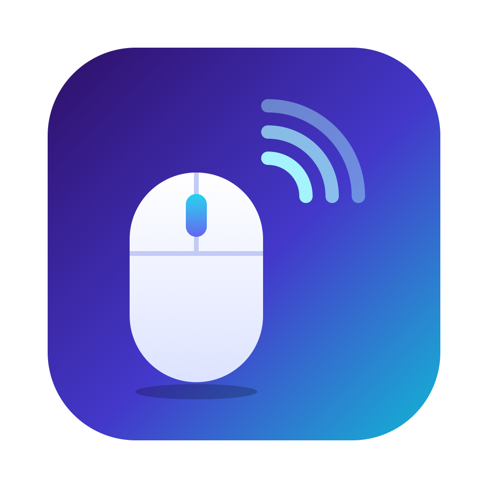
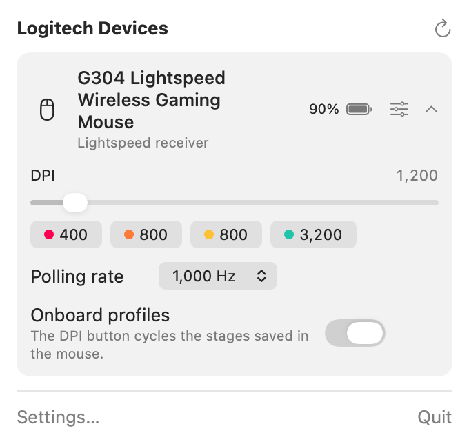
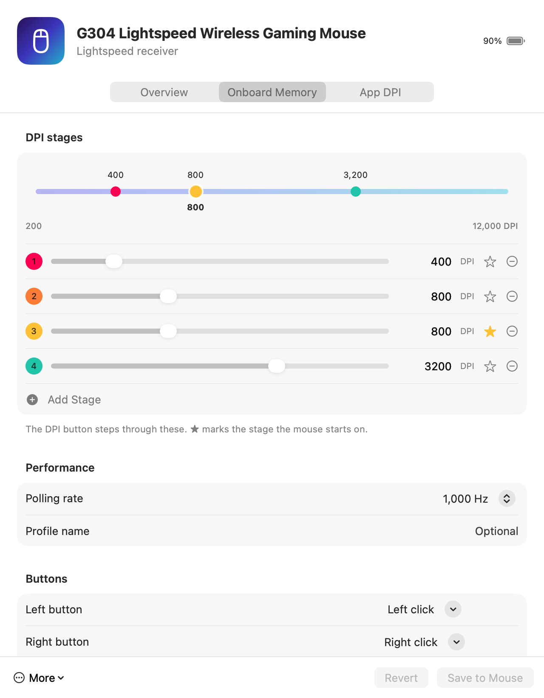

<div align="center">



# LogiBar

**Control your Logitech mouse and keyboard from the macOS menu bar.**<br>
DPI, polling rate, SmartShift, battery and more — without G HUB, Options+ or any Logitech software.

[](#install)
[](https://swift.org)
[](LICENSE)
[](https://github.com/shashankanil/logibar/releases/latest)

<picture>
  <source media="(prefers-color-scheme: dark)" srcset="assets/screenshot-dark.png">
  
</picture>

</div>

## Why

Logitech's apps are big, need background daemons, and are split by product line — G HUB for G
series, Options+ for MX and everything else. LogiBar is one ~2 MB native app that talks to the
hardware directly.

| | LogiBar | G HUB | Options+ |
| --- | :---: | :---: | :---: |
| G series **and** MX / ERGO / POP / K-series in one app | ✅ | — | — |
| Edit onboard memory: DPI stages, polling rate, button mapping | ✅ | ✅ | — |
| Automatic backup of onboard memory before every write | ✅ | — | — |
| One-click DPI stage switching from the menu bar | ✅ | — | — |
| Per-app DPI | ✅ | ✅ | — |
| Install size | ~2 MB | hundreds of MB | hundreds of MB |
| Open source | ✅ | — | — |

## Features

### Onboard memory editor

<picture>
  <source media="(prefers-color-scheme: dark)" srcset="assets/memory-dark.png">
  
</picture>

For mice with onboard profiles (most G series), edit what's stored **in the mouse itself** — it
keeps working on any computer, with no software running:

- **DPI stages** — up to 5, any value the sensor supports, on a log-scale ladder; ★ picks the stage
  the mouse starts on
- **Button mapping** — mouse buttons, keyboard shortcuts (recorded live), media keys, DPI
  cycle/next/previous/shift, profile switching, scroll and tilt, or disable a button
- **Polling rate** and **profile name**, and the **active profile** on multi-profile mice
- **Safe writes** — every sector is read back and verified; the previous memory is backed up
  automatically, and you can restore any backup or reset to factory defaults in one click

### Everything else

| | Setting | Typical devices |
| --- | --- | --- |
| 🔋 | Battery level, charging state, low-battery alerts | All wireless devices |
| 🎯 | DPI slider, plus one-click stage chips in the menu | G series, MX Master / Anywhere, most mice |
| 🪟 | Per-app DPI — switches automatically when an app comes to the front | Any mouse with adjustable DPI |
| ⚡ | Polling rate (125 Hz – 8 kHz) | Gaming mice |
| 💾 | Onboard profiles on/off | G series with onboard memory |
| 🛞 | Ratchet / free spin and SmartShift sensitivity | MX Master, MX Anywhere |
| ↕️ | Scroll direction and high-res scrolling | Mice with the HID++ hi-res wheel |
| ⌨️ | Media keys vs. F1–F12 by default | MX Keys, K-series keyboards |
| 🔀 | Easy-Switch channel | Multi-device mice and keyboards |

Settings changed outside onboard memory are saved per device and re-applied when it reconnects or
wakes, since many devices forget host-set values after a power cycle.

## Install

### Download

1. Grab **LogiBar.zip** from the [latest release](https://github.com/shashankanil/logibar/releases/latest)
   and unzip it.
2. Move **LogiBar.app** to your Applications folder.
3. The build is ad-hoc signed rather than notarized, so the first time **right-click → Open → Open**
   (or run `xattr -dr com.apple.quarantine /Applications/LogiBar.app`).
4. Tick **Launch at login** in the menu if you want it to start automatically.

### Build from source

```sh
git clone https://github.com/shashankanil/logibar.git
cd logibar
./scripts/build-app.sh --install   # builds, copies to ~/Applications and launches
```

Requires macOS 14+ and Xcode or the Swift 5.10+ toolchain.

## Tips

- **Onboard profiles on or off?** On: the DPI button cycles the stages saved in the mouse — edit
  them under *Settings → Onboard Memory*. Off: LogiBar holds one fixed DPI and the button won't
  cycle.
- **Device shows "asleep or off"?** Wireless devices don't answer while sleeping. Move the mouse or
  press a key — it reappears within a minute, or hit ↻.
- **Backups** live in `~/Library/Application Support/LogiBar/Backups` (also *Settings → General*).
- **Got Logi Options / Options+ or G HUB installed?** Quit them; two apps writing the same settings
  will fight each other.

## How it works

Logitech devices speak **HID++ 2.0**, a vendor protocol carried over ordinary HID reports. Each
device exposes a table of numbered features (battery, DPI, wheel…), which LogiBar discovers at
runtime and drives through IOKit — no kernel extension, driver or special permission needed.

| Area | HID++ features |
| --- | --- |
| Identity | `0x0003` device info, `0x0005` name and type |
| Battery | `0x1000` status, `0x1001` voltage, `0x1004` unified battery |
| Pointer | `0x2201` adjustable DPI, `0x8060` / `0x8061` report rate |
| Onboard memory | `0x8100` profiles: memory read/write, active profile, DPI stage select |
| Wheel | `0x2110` / `0x2111` SmartShift, `0x2121` hi-res wheel |
| Keyboard | `0x40A0` / `0x40A2` / `0x40A3` Fn inversion |
| Multi-host | `0x1814` change host |

```
Sources/LogiBar/
├── HIDPPTransport.swift   # raw HID++ request/response over one IOHIDDevice
├── HIDPPDevice.swift      # feature discovery, reading state, setters
├── OnboardMemory.swift    # onboard profile format, CRC, sector read/write, backups
├── KeyCodes.swift         # macOS key codes → USB HID usages for shortcut mapping
├── DeviceManager.swift    # hot-plug, receiver slots, rescans, saved settings, per-app DPI
├── BatteryAlerts.swift    # low-battery notifications
├── MenuView.swift         # SwiftUI menu bar panel
├── SettingsWindow.swift   # settings window: devices, app DPI, general
├── OnboardEditor.swift    # DPI stages, button mapping, backup/restore UI
└── main.swift             # app entry, --dump and --snapshot dev modes
```

Protocol details are thanks to the reverse-engineering work in [Solaar](https://github.com/pwr-Solaar/Solaar)
and [libratbag](https://github.com/libratbag/libratbag).

## Development

```sh
swift build -c release
LOGIBAR_DEBUG=1 .build/release/LogiBar --dump        # print detected devices and settings (read-only)
.build/release/LogiBar --snapshot out.png [--light] [--tab memory]  # render the menu or a settings tab
swift scripts/render-icon.swift                      # regenerate logo.png / AppIcon.icns from logo.svg
```

## Roadmap

- [x] Onboard memory editor: DPI stages, button mapping, polling rate
- [x] Per-app DPI
- [ ] Macros in onboard memory
- [ ] Button remapping for non-G mice (HID++ `0x1B04` reprogrammable keys) and gestures
- [ ] RGB lighting and keyboard backlight
- [ ] Show paired-but-offline devices from receiver pairing info
- [ ] Signed and notarized releases, Homebrew cask

Tested so far on a **G304** (Lightspeed). If LogiBar works — or doesn't — with your device, please
[open an issue](https://github.com/shashankanil/logibar/issues) with the output of
`LOGIBAR_DEBUG=1 LogiBar --dump`. PRs welcome.

## License

[MIT](LICENSE). Not affiliated with or endorsed by Logitech. Logitech, G HUB, Logi Options+,
Lightspeed, Unifying and Bolt are trademarks of Logitech.
